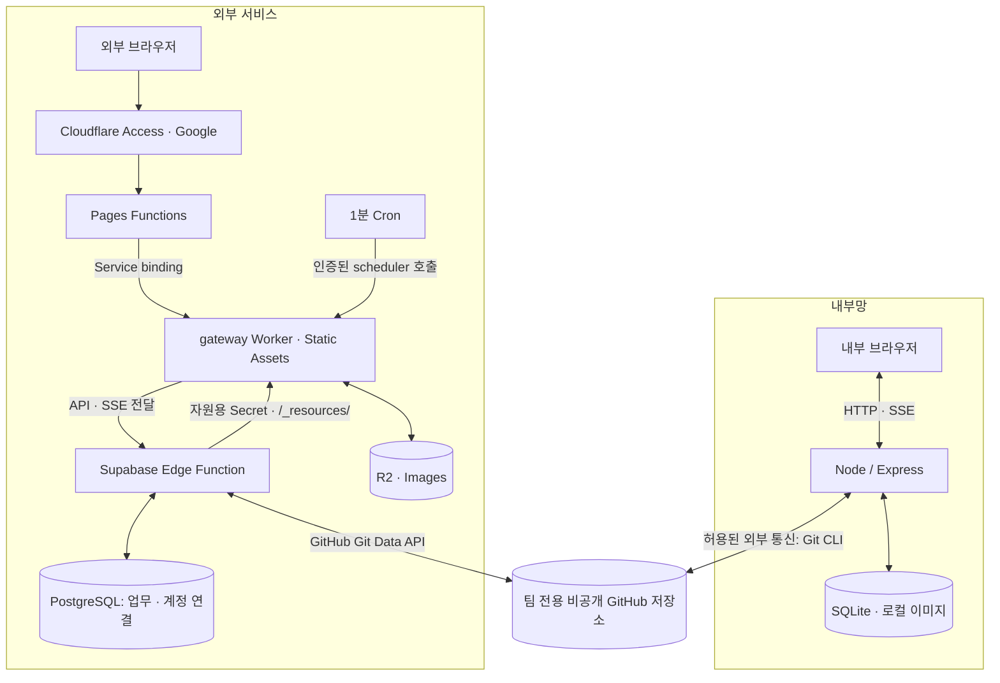
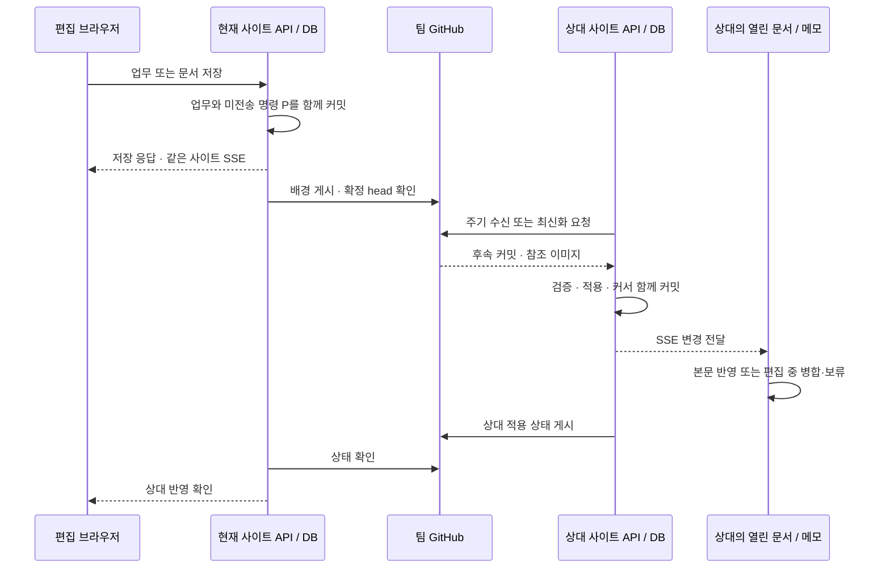

# 그래보드 구성과 데이터 흐름

[처음으로](../README.md) · [설치 안내](CLOUD_SETUP.md) · [운영 안내](OPERATIONS.md) · [동기화 규약](SYNC_PROTOCOL.md)

현재 기본 구성은 내부 Node/SQLite 서버와 팀별 외부 Supabase Edge Functions 사이트입니다. 내부 서버는 GitHub에만 접속하며, 외부 업무 API는 Supabase에서 실행합니다. Cloudflare는 Pages 주소, Google Access, HTTP 전달, 정적 파일과 이미지 자원을 담당합니다. Hyperdrive는 사용하지 않습니다.

이 문서는 저장소 구현 기준의 구성도입니다. 실제 배포 커밋·프로젝트·설치 UUID·Secret 등록 상태는 별도 운영 기록으로 관리합니다.

## 배포 구성

브라우저 응답과 SSE는 같은 진입 경로를 거쳐 돌아옵니다. 내부 Node는 Supabase·R2·Cloudflare 관리 API에 직접 연결하지 않습니다. 외부 자원 초기화·배포·백업은 인터넷에 연결된 운영자 환경에서 수행합니다.

| 구성요소          | 역할                                                           | 구현·설정                                                                            |
| ----------------- | -------------------------------------------------------------- | ------------------------------------------------------------------------------------ |
| 내부 Node         | 내부 계정·세션, 모든 팀의 업무 API, 파일 이미지, Git 발신·수신 | `server/`, `.env`, `GRAEBOARD_SITE=internal`                                         |
| 팀 데이터 GitHub  | 업무 확정 이력, 이미지, 구성원·연결 키 해시·적용 상태 전달     | `server/sync/`, [브랜치 규약](SYNC_PROTOCOL.md#git-브랜치별-역할)                    |
| Cloudflare Access | 외부 주소의 Google 로그인                                      | 팀 전용 Access 앱, `ACCESS_ISSUER`, `ACCESS_AUDIENCE`                                |
| Pages Functions   | 모든 경로를 gateway로 전달                                     | `functions/[[path]].js`, `public/_routes.json`, `GRAEBOARD_BACKEND`                  |
| gateway Worker    | Edge 호출, Access JWT 검증 후 정적 파일 제공, R2/Images 접근, Cron 전달   | `worker/gateway.mjs`, `wrangler.gateway.jsonc`                                       |
| Supabase Edge     | Access JWT 검증, 앱 계정·팀 권한, 업무 API, Git 동기화, SSE    | `edge/main.mjs` → `edge/handler.mjs` → `worker/entry.mjs`, `GRAEBOARD_SITE=external` |
| PostgreSQL        | 팀 업무와 외부 계정·승인·세션                                  | 팀별 프로젝트의 `graeboard`와 `graeboard_site` 스키마                                |
| R2 / Images       | 외부 문서 이미지 저장·변환                                     | gateway의 `R2_TEAM`, `IMAGES` binding                                                |

`worker/`에는 이전 배포에서 이어받은 공통 API 구현도 있습니다. 디렉터리 이름과 실제 실행 위치를 구분합니다. 현재 업무 코드는 Edge의 Deno 런타임에서 실행하고, Cloudflare Worker에서는 전달·정적 파일·이미지 자원 처리를 실행합니다.

Edge는 `pg.Pool`로 PostgreSQL에 연결합니다. `PG_SITE`는 프로필에서 이 저장소를 가리키는 내부 이름이며 Hyperdrive binding이 아닙니다. R2/Images는 Edge가 자원용 Secret으로 gateway에 요청합니다. gateway에는 DB 비밀번호와 팀 Git 토큰을 등록하지 않습니다. Supabase Auth·Data API도 이 앱의 인증·업무 저장 경로에 필요하지 않습니다.

외부 연결 팀마다 데이터 Git 저장소, Supabase 프로젝트, Pages/gateway, Access 앱, R2 bucket을 준비합니다. 내부는 기존 SQLite 하나에서 모든 팀을 관리합니다. 앱 **소스 저장소**의 브랜치·배포와 팀 **데이터 저장소**의 동기화 브랜치는 별개입니다.

## 로그인과 최초 연결

| 항목              | 내부                                   | 외부                                        |
| ----------------- | -------------------------------------- | ------------------------------------------- |
| 로그인            | 내부 아이디·비밀번호                   | Google Access 후 사내 계정 연결             |
| 최초 팀 자료 연결 | 팀 프로필 선택 → 연결 검사 → 초기 게시 | 서비스 연결 검사 → 팀 가져오기              |
| 팀장 연결 키      | 해당 팀장이 발급·재발급·폐기           | Google 로그인 후 본인 사내 계정과 키로 연결 |
| 구성원·역할 관리  | 원본 계정·멤버십 관리                  | 내부 변경 수신, Google 연결 승인·거절·해제  |
| 동기화            | 로컬 저장 후 Git 게시·수신             | 로컬 저장 후 Git 게시·수신                  |

`GRAEBOARD_SITE`는 서버의 고정 역할을 확인하는 설정입니다. 접속 주소나 네트워크 연결 여부로 자동 추측하지 않으며, 방화벽을 설정하는 변수도 아닙니다. 내부 Node에 `external`, 외부 API에 `internal`을 지정하면 설정 오류로 거절합니다.

팀장 연결 키는 내부 화면에서 생성한 256비트 난수이며 24시간 동안 한 번만 사용할 수 있습니다. 원문은 발급 응답에서만 보여 줍니다. 해시·대상 팀/사용자·유효기간을 GitHub로 전달하고, 외부 PostgreSQL에서 검증·소비·Google 신원 연결을 한 트랜잭션으로 처리합니다. 사용자는 소스 코드나 `setup-token.txt`를 확인할 필요가 없습니다. 내부 첫 관리자 생성용 `SETUP_TOKEN`과 다른 기능입니다. 상세 절차는 [Google Access와 계정 연결](CLOUD_SETUP.md#8-graeboard-전용-google-access)에 있습니다.

`*.프로젝트.pages.dev` 미리보기 정책과 `프로젝트.pages.dev` 운영 주소 보호를 각각 설정합니다. 유효한 Google/Access 세션이 있으면 로그인 화면을 매번 다시 표시하지 않습니다. Access 통과 후에도 앱의 계정 연결·팀 권한 검사를 통과해야 업무를 사용할 수 있습니다.

## 저장부터 열린 화면 반영까지

두 방향 모두 같은 원칙입니다. **사이트 간 Git 전달**과 **한 사이트 안의 브라우저 SSE**는 별개입니다. 내부 저장과 같은 내부 서버의 SSE는 Git 게시를 기다리지 않습니다. 상대의 열린 화면에는 상대 DB가 변경을 수신한 다음 SSE로 반영합니다. 내부에서 외부 브라우저로 직접 연결하지 않습니다.

내부의 기본 동기화 주기는 약 60초이며 저장 후 게시도 예약합니다. 외부는 저장 묶음 처리, 진입·포커스의 최신화, gateway의 1분 Cron을 사용합니다. 네트워크·작업 대기·재시도에 따라 더 늦어질 수 있으며 사이트 간 즉시 반영 시간을 보장하지 않습니다. [주기와 적용 확인](SYNC_PROTOCOL.md#git-전달과-적용-확인)을 참고하세요.

업무 문서·원본/사본 연간 메모·일정 문서는 열어 둔 상태에서도 자동 반영합니다. 리치 편집과 Markdown 원문 편집이 같은 저장·구독 경로를 사용합니다. 조합 입력·업로드·저장 중에는 변경을 보류하고, 동시 수정은 입력을 보존하며 병합 또는 충돌 처리합니다. [사용 안내](USER_GUIDE.md#문서와-메모의-자동-반영)

문서 본문의 `sync.sequence`와 SSE 재연결 커서는 목적이 다릅니다. 외부 문서의 GET·PUT·충돌 응답·SSE는 같은 문서 revision 기준의 `sync`를 사용하고, SSE 전송은 `pg:<site_events cursor>`로 이어받습니다. 전역 이벤트 커서로 문서 순서를 덮어쓰면 열린 문서가 새 본문을 오래된 이벤트로 오인할 수 있습니다. [데이터 계약](DATA_FORMAT.md#실시간-동기화)

외부 화면 상단의 **외부 클라우드 저장 → Git 반영 → 내부망 반영 대기/완료** 태그는 저장·게시·내부 서버 적용 단계를 나타냅니다. 대기·진행 중은 회색, 완료는 푸른색이며 내부망 반영 완료가 모든 브라우저의 렌더링 완료를 뜻하지는 않습니다. 내부 화면에서는 정상·대기 태그를 숨기고 오류·충돌·복구 필요·동기화 중단만 표시합니다. 표시를 숨겨도 상태 조회와 서버 동기화는 계속 수행합니다.

## 배포와 복구의 경계

- 프런트엔드는 `npm run build` 결과를 gateway Static Assets와 함께 배포합니다. Pages의 Git 자동 빌드만으로 gateway의 파일이 갱신되지 않습니다.
- API와 앱 내 설치 안내는 `npm run build:edge` 후 Supabase 함수를 배포합니다. `docs/CLOUD_SETUP.md`는 함수에 포함되므로 문서 파일 수정만으로 실행 중 안내가 바뀌지 않습니다.
- Pages Functions·Service binding 변경은 Pages 재배포가 필요합니다. 운영 주소는 선택한 Production branch를 사용합니다.
- 이전 전체 Worker 이름의 Service binding은 `worker/forwarder.mjs`로 gateway에 전달할 수 있습니다. 이전 Worker의 DB·Git·Hyperdrive binding과 Cron은 제거합니다. 전체 Worker 업무 실행용 설정·빌드·호환성 테스트는 제거했습니다.
- 동기화 명령의 형식·검증·병합 규칙이 바뀌는 릴리스는 사내 서버(Node)와 외부 서버(Supabase `graeboard` 함수)를 같은 버전으로 연이어 배포합니다. 새 형식을 읽을 수 있는 쪽을 먼저 배포하며, 2026-10-30의 사본 공유 사전 형식은 **외부 서버 → 사내 서버** 순서입니다. [운영 안내](OPERATIONS.md#내부외부-git-동기화-운영)
- Edge 전환은 DB 스키마 변경과 별개입니다. 접속 토큰 도입까지 포함한 현재 버전은 SQLite v33, PostgreSQL team v2/site v3(분리형 control v2), 외부 백업 v3입니다. 백업·복구·논리 이관은 각각 [운영 안내](OPERATIONS.md#백업과-복구)와 [외부 복구 절차](CLOUD_SETUP.md#12-정리중단복구)를 따릅니다.

Edge 전환 후에도 애플리케이션의 PG 용량 제한과 각 서비스의 실행·요청 한도는 남습니다. 과거 workerd 성능 측정과 현재 Edge 실행 검증을 구분합니다. [실행 한도와 검증 범위](CLOUD_SETUP.md#15-실행-한도와-검증-범위)

## 리뷰 반영 구조

내부 `createApp`은 SQLite 구성만 담당하고 HTTP 경계·로컬 인증·권한 조회를 `http-boundary.mjs`, `local-auth.mjs`, `sqlite-access.mjs`로 나눕니다. 공통 HTTP 라우트 표는 `shared/business-routes.js`, 외부 PostgreSQL 구현은 `worker/storage/`에 둡니다. 외부가 내부 Node 호스트를 역참조하지 않도록 import 방향을 검사합니다. 워크북 parser는 `shared/workbook.mjs`에서 직접 공유하며 빌드 중 소스 문자열을 잘라 생성하지 않습니다.

내부·외부는 동기화 로직을 제외한 저장 방식과 코드 흐름을 같게 유지합니다. 예를 들어 사본 `data`는 사내 BLOB·HTTP 응답·동기화 명령·외부 `site_entities`에서 모두 `shared/compact.js`의 공유 사전 형태이며, `shared/report-sync-data.js`가 동기화·외부 저장 경계에서만 직렬화·해제합니다. 한쪽에만 다른 형식을 두면 한 사이트에서는 되고 다른 사이트에서는 실패하는 차이가 생기므로, 새 기능도 공통 모듈을 재사용합니다. [사본 저장 형태](DATA_FORMAT.md#보기사본계정)

Node 동기화는 팀별 큐를 두 실행 슬롯에 배치합니다. 진행 단계마다 5분 무진행 제한을 갱신하고 실제 진행에 맞춰 소유 lease를 연장합니다. 시간 초과 요청의 I/O를 취소한 뒤 해당 worker만 종료하며 다른 슬롯·대기 요청은 유지합니다. C 캐시는 팀·저장소·설치·발신 세대·head·hash·복구 세대에 묶고 commit 성공 뒤 공개합니다. C/P 원자 commit과 snapshot guard는 `node-mutations.mjs`에서 유지합니다. 상태·연결 라우트, SSE 알림, 오류 기록은 각각 독립 모듈입니다.

원격 task의 서식·순서 변경은 셀 SSE에 메타데이터를 싣습니다. 생성·삭제·복원·연도 변경이나 retention 변경은 범위 snapshot을 다시 요청합니다. 빈 canonical 변경은 알림을 보내지 않습니다. retention 활성 조회도 팀 단위 메타데이터와 revision을 사용해 캐시합니다.
